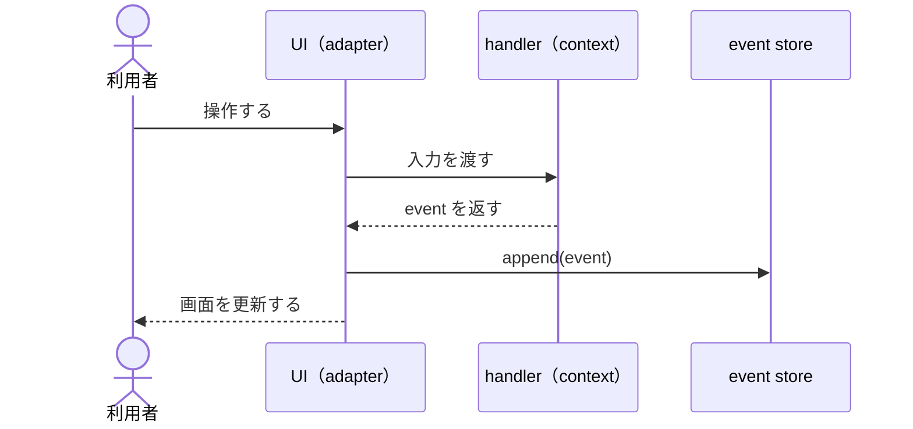

# 決める紙（重い変更用の Issue のひな形・案）

使うのは次のような変更のとき: 認証・課金・データの形・外部サービス連携・画面や作品の方向性が変わるもの、PR が 3 本以上になりそうなもの。
下敷きは、Issue で設計してうまくいっていた型（なぜ／方針／段階／決めてほしいこと）。そこに「完成の姿」と「やらないこと」を足した。

---

## なぜ

<困っていること・機会。2〜3 行>

## 完成の姿（目標の図）

<出来上がったときに何が見えるか。図・画面・数値。作業中はここを目標にする。テストで見つかった「欠けの一覧」を目標にしない（目標の図があったのに、欠けを消すことが目標になって作り直した例があった）>

## 主要な流れ

<実装の前に、この変更で動く主な流れを Mermaid のシーケンス図 1 枚で描く（1 つの流れ = 1 枚）。参加者は context・adapter・外の世界。分岐は `alt`、繰り返しは `loop`。流れが複数あるときは、いちばん重い 1 つを描く。流れが無い変更（文言・設定の追加など）は「なし」と書く>

<図の決まり: 題と凡例をつける。1 枚は 15 ノード未満。線には具体的なラベルをつける。参加者の名前に `<` `>` `;` を使わない（Mermaid の区切りと解釈されて、図が 1 枚描画されない）。書いたら GitHub 上で描画を見る>

## 方針

<どう作るか。3〜5 行>

## 段階

| 段階 | やること | 通る context | 確かめ方 | 状態                     |
| ---- | -------- | ------------ | -------- | ------------------------ |
| 0    |          |              |          | #<子 Issue か PR の番号> |
| 1    |          |              |          | #<同上>                  |

<1 段 = 1 本の PR で、動く形まで届く縦の切り方（画面だけ・DB だけと層で切らない）。「通る context」はその段で動く context（無ければ —）。「状態」の欄は、子 Issue（sub-issue）か PR の番号だけを書く。済・作業中は GitHub が示す状態を見る。表に「済」と手で書かない（状態の正本は Issue・PR の 1 か所）>

## 決めてほしいこと

1. <問い> — 推奨: <案>（理由）
2. …

## やらないこと

- <この Issue では触らない範囲>

## 危ないところ

- <壊れやすい所、戻しにくい所、外部の制約>

## 今の仕様に書き戻す所

- <この変更で古くなる、今の仕様の文書と節（SPEC・画面ごとの現状仕様・README など）。PJ にそういう文書がなければ「なし」>

---

## 運用

- 決まったら、コメントに「## 決定（YYYY-MM-DD）」を書く。本文の「決めてほしいこと」も決定に書き換える
- 版を上げるときは本文を上書きする（Artifact や別の文書に分けない。正本は 1 か所）
- 段階が 3 つ以上あるときは、段階ごとに子 Issue（sub-issue）を立て、「段階」の表の「状態」の欄に番号を書く。段階の PR の本文には `Closes #<子 Issue>` を書く（マージで子が閉じる）。親（この紙）は、全段階が済んでから閉じる
- 進捗の状態の正本は、Issue・PR の open・closed・merged だけ。表・図・ROADMAP に「済」と手で書かない（二重になって食い違う）。GitHub Projects を使う PJ は、親と子の Issue を Board・Roadmap に載せる。「PR をマージしたら Done」の自動化に任せ、手でステータスを動かさない
- 段階が終わるごとに、PR 番号をコメントに書く（経緯の記録。状態の正本ではない）
- 全段階が終わったら、「今の仕様に書き戻す所」を、最後の段階の PR の中で書き直してから close する。書き直した節を、close のコメントに書く
- 見出しの「## 完成の姿」「## 決めてほしいこと」「## 決定」は変えない。マージの関門の hook（release-gate）が、この見出しで決める紙を見分ける
- 決定の前に、REVIEW NEEDED のラベルを付けた PR をマージしない
